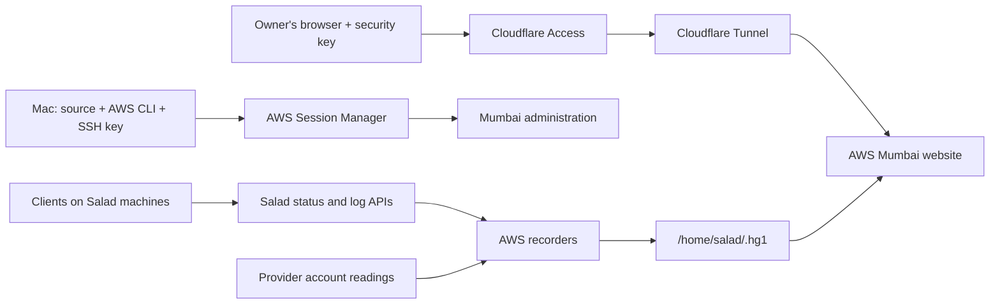

# Website connections

Measured from AWS and the signed-in Cloudflare console on 7 September 2026. The subsequent verified security cutover uses the Unix origin below. IDs identify current objects; recreated objects receive new IDs.



AWS hosts observers, not the bandwidth-sharing clients. Its IAM role connects the host to Session Manager and the dedicated Secrets Manager secret. A separate Salad API key authenticates recorder requests. Some protocol-approved recorder recovery paths also issue cloud-control requests; read the protocol guide before changing them. Provider credits use separate provider access. Account keys do not belong in browser JSON.

## AWS

| Item | Current measured value / console |
|---|---|
| Account / region | `163092837436` / `ap-south-1` (Mumbai) |
| Instance | [salad-dashboard-mumbai](https://ap-south-1.console.aws.amazon.com/ec2/home?region=ap-south-1#InstanceDetails:instanceId=i-0491397473a219afa), `i-0491397473a219afa`, `ap-south-1a` |
| Compute / OS | `t4g.small`, ARM64; Ubuntu 24.04.4 LTS; Python 3.12.3 |
| CPU credits | `unlimited`; Standard mode reproduced page timeouts after credits ran out |
| VPC / subnet | `vpc-0065bda238de29006` / `subnet-0b29a24b5c27c0c88` |
| Security group | `sg-0e30d5b67a59d6270`, `salad-dashboard-mumbai`; no inbound rules; outbound IPv4 allowed |
| Root volume | `vol-016d948188739d4a3`; 50 GiB encrypted gp3, 3000 IOPS, 125 MiB/s throughput; `/dev/sda1` |
| Deletion setting | Root volume has DeleteOnTermination enabled; preserve a backup before deleting the host |
| IAM profile / role | `salad-dashboard-mumbai`; EC2 trust and the captured `SaladSessionManager` policy are in [linux/](linux/) |
| Instance metadata | IMDSv2 required, hop limit 1; IPv6 metadata endpoint disabled |
| Application / data | `/opt/salad` / `/home/salad/.hg1` |
| Recorder credentials | AWS Secrets Manager `salad/mumbai/recorder-credentials`; ARN `arn:aws:secretsmanager:ap-south-1:163092837436:secret:salad/mumbai/recorder-credentials-BTrNOt` |
| Credential cache | `/run/salad-credentials`, private tmpfs owned by `salad`; regenerated after reboot, not the backup |
| Tunnel token | `/etc/cloudflared-salad/tunnel.token`; private input |
| Startup | [Linux systemd units](linux/systemd/) |

DNS targets the tunnel ID, not the EC2 IP. Neither the tunnel nor SSM needs an EC2 inbound port. [AWS Session Manager connection requirements](https://docs.aws.amazon.com/systems-manager/latest/userguide/session-manager-working-with-sessions-start.html).

## Connect from a Mac

Required: the owner's AWS CLI login/profile, AWS CLI and Session Manager plugin on PATH, and the SSH key whose public half is installed for `ubuntu`. The current private-key path is `~/.ssh/cosmos_ed25519`; never put it in the repository.

```sh
cd "$HOME/Desktop/salad"
aws sts get-caller-identity
ssh -F Website/linux/ssh_config salad-mumbai
```

The [SSH configuration](linux/ssh_config) uses `AWS-StartSSHSession` in Mumbai. SCP uses the same path:

```sh
scp -F Website/linux/ssh_config Website/source/dashboard/static/fleet-test.js salad-mumbai:/tmp/fleet-test.js
```

This only stages the file. [OPERATIONS.md](OPERATIONS.md) gives installation and verification steps.

The `ubuntu` SSH account has no general sudo grant and does not belong to `sudo` or `lxd`. Its only exceptions are the fixed credential-renewal commands in [salad-credential-renewal](linux/sudoers/salad-credential-renewal): write-only credential entry as `salad`, a masked RP access check, and start/stop of the RP/PS provider readers. No root shell, arbitrary interpreter, or direct credential read is allowed. SSH listens only on `127.0.0.1:22`, reached by the local SSM Agent; the security group still has no inbound rules. Root and password SSH logins are disabled. Do not restore blanket sudo to make a deployment command work.

Privileged maintenance uses the existing IAM-authorized **AWS Run Command**, not sudo from the routine SSH session. From the Mac, this read-only example verifies the separate root path:

```sh
aws ssm send-command --region ap-south-1 --document-name AWS-RunShellScript \
  --instance-ids i-0491397473a219afa --parameters '{"commands":["id"]}' \
  --query Command.CommandId --output text --no-cli-pager
aws ssm get-command-invocation --region ap-south-1 --command-id COMMAND_ID \
  --instance-id i-0491397473a219afa --no-cli-pager
```

Replace `COMMAND_ID` with the returned identifier. Run Command is a privileged path: submit only the authorized maintenance operation, keep secrets out of command arguments/output, and check its exit status. Host-side `sudo` examples in the recovery/setup guides assume this root maintenance context, not the routine SSH account.

If the Mac/key is lost but AWS survives, open the instance in the AWS console → **Connect → Session Manager** with the owner/admin login. Re-enroll a new operator SSH public key in `/home/ubuntu/.ssh/authorized_keys`; never add the private key. After replacing EC2, update `HostName` in the SSH configuration and authorize the new instance in the operator's IAM session policy.

The routine CLI identity is scoped: it denied `DescribeImages` and `DescribeRouteTables` during this capture. Use the owner/admin console for provisioning and IAM changes. An ordinary read failure does not justify broadening the application's role.

## Cloudflare

| Item | Current measured value / console |
|---|---|
| [Account and zone](https://dash.cloudflare.com/bbe588a8dcf3dd3bca569b3786bca2eb/cosmosgeek.org) | Account `bbe588a8dcf3dd3bca569b3786bca2eb`; zone `cosmosgeek.org`, ID `d13d90cfd0da52f9a9152a94b98073a4` |
| Nameservers | `rudy.ns.cloudflare.com`, `sandy.ns.cloudflare.com`; a newly created zone may receive different nameservers |
| [DNS](https://dash.cloudflare.com/bbe588a8dcf3dd3bca569b3786bca2eb/cosmosgeek.org/dns/records) | Proxied CNAME `salad` → `3d78c009-10b3-4d6b-96cf-a2a46ee1c42e.cfargotunnel.com`; TTL Auto |
| [Tunnel](https://dash.cloudflare.com/bbe588a8dcf3dd3bca569b3786bca2eb/tunnels/3d78c009-10b3-4d6b-96cf-a2a46ee1c42e/overview) | `cosmosgeek-salad`, ID `3d78c009-10b3-4d6b-96cf-a2a46ee1c42e`; remotely managed |
| [Published route](https://dash.cloudflare.com/bbe588a8dcf3dd3bca569b3786bca2eb/tunnels/3d78c009-10b3-4d6b-96cf-a2a46ee1c42e/routes) | Host `salad.cosmosgeek.org`; blank path; origin `unix:/run/salad-ui/ui.sock`; Protect with Access on |
| Team | `dawn-base-75dc` |
| [Access app](https://dash.cloudflare.com/bbe588a8dcf3dd3bca569b3786bca2eb/one/access-controls/apps/self-hosted/50f0f41a-633c-4e17-be10-9a2304eb0e61/edit?tab=basic-info) | Self-hosted `salad`, ID `50f0f41a-633c-4e17-be10-9a2304eb0e61`; full hostname, blank path; session 1 week |
| Application AUD | `745e29c574f51f5d1d68b1272034c25ae083f6141281c3cfc35cad0749d6623a`; also in the tunnel's Access validator |
| [Policy](https://dash.cloudflare.com/bbe588a8dcf3dd3bca569b3786bca2eb/one/access-controls/policies/b765a4f9-60d9-4436-8d46-5fbce16f9623/edit) | `only me`, ID `b765a4f9-60d9-4436-8d46-5fbce16f9623`; Allow; Include Emails `cosmosgeek@proton.me`; no Require/Exclude entries |
| Login provider | Cloudflare ID `a9603038-7f0f-4ad3-84f5-582429c4342f`; restrict to account members; app selects only this provider |
| MFA | App custom MFA: security key, 24 hours; global security-key method on, other methods off |
| Identity/session details | Accept-all identity providers off; Cloudflare One Client authentication off; policy inherits app session, MFA override off and JIT off; identity-provider MFA matching on for 24 hours; global session inherits app |
| Sessions/cookies | Instant authentication on; HTTPOnly and binding cookie on; eager redirect on; cookie path enforcement off; SameSite unselected; CORS bypass off |

The physical security key is the owner's login factor, not an API key installed on EC2. Cloudflared validates Access JWTs; the website also checks the connecting Unix UID and expected claims. A replacement Access application has a new AUD: update both the tunnel validator and `ACCESS_AUDIENCE` in `dashboard/server.py`. A replacement tunnel has a new CNAME target. [RECOVERY.md](RECOVERY.md#restore-cloudflare) gives the order.

The UI runs as `salad-ui` with read-only code/data mounts and no IPv4/IPv6 networking. The tunnel runs as `cloudflared-salad`, belongs to the `salad-ui` group for socket access, and is denied IMDS. Its capability bounding set is empty; kernel/control-group changes, new namespaces, realtime scheduling and SUID/SGID creation are restricted. Recorders run as `salad` and use the EC2 role to read/update the single Secrets Manager secret. The old `/home/salad/.credentials` directory and HTTP listener are retired.

## Salad groups and protocol source

Open [Salad organizations](https://portal.salad.com/organizations), then the named organization → default project → container group. Discover current IDs from the API or console; old UUIDs must not be used for recreated groups.

| Page | Organization / group | Source and cloud recovery |
|---|---|---|
| Honeygain | `deathadder` / `hg1`, `hg-solo-02` through `hg-solo-10` | [Honeygain](../Honeygain/README.md) |
| PacketStream | `hyperlane` / `ps-test-us` | [PacketStream](../PacketStream/README.md) |
| Proxyrack | `ssh1` / `pr` | [proxyrack](../proxyrack/README.md) |
| Repocket | `ssh2` / `rp-test-us` | [repocket](../repocket/README.md) |
| EarnFM | `ssh3` / `earnfm-us` | [EarnFM](../EarnFM/README.md) |
| Traffic Monetizer | `ssh4` / `tm-test-us` | [TraffMonetizer](../TraffMonetizer/README.md) |
| Pawns.app | `cosmosgeeketh` / `pawns` | [pawns](../pawns/README.md) |
| EarnApp | `cosmosgeeketh` / `earnapp-live` | [EarnApp](../EarnApp/README.md) |
| Grass | `cosmosgeeketh` / `grass` | [grass](../grass/README.md) |

[DATA.md](DATA.md) maps routes to ledgers. [OPERATIONS.md](OPERATIONS.md#services) maps services to executable files. Provider logins and client recovery policies belong to the protocol guides.
